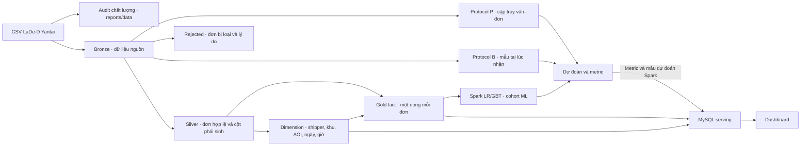

# Nguồn dữ liệu và cách tạo tập huấn luyện LaDe-D

Với bộ Yantai của repo, cả ba nhánh bắt đầu từ cùng file **`data/delivery_yt.csv`**.
Khi pipeline chạy, mỗi nhánh dựng bảng học riêng. **Đặc trưng** là các cột mô hình
đọc để dự đoán. **Nhãn** là số phút thực tế dùng để học hoặc chấm dự đoán.

| Nhánh huấn luyện | Đọc trực tiếp từ đâu | Một dòng trong tập học | Mốc truy vấn và nhãn |
| --- | --- | --- | --- |
| **Protocol P · LightGBM** | Delta `delivery_bronze` | Một cặp (lần truy vấn, đơn còn cầm) | Truy vấn khi shipper vừa giao một đơn. Nhãn là số phút còn lại để giao đơn mục tiêu, giữ cặp có nhãn trong (0, 120]. |
| **Protocol B · LightGBM** | Delta `delivery_bronze` | Một đơn tại lúc nhận, sau khi lấy mẫu tối đa 12 đơn mỗi shipper mỗi ngày | Truy vấn khi nhận đơn. Nhãn là toàn bộ thời gian từ lúc nhận đến lúc giao. |
| **Spark LR/GBT** | Delta `fact_delivery_task_gold` dựng từ Silver | Một đơn thuộc tập có GPS hợp lệ, khoảng cách tối đa 50 km và thời lượng tối đa 24 giờ | Truy vấn khi nhận đơn. Đích là `delivery_minutes`, đưa vào mô hình dưới dạng `log1p(delivery_minutes)`. |

Ví dụ, một đơn được nhận lúc **08:00** và giao lúc **10:10** có nhãn **130 phút** trong Protocol B và Spark nếu đủ điều kiện vào tập. Nếu shipper giao một đơn khác lúc **09:00**, Protocol P có thể tạo một mẫu cho đơn còn cầm đó với nhãn **70 phút**. Một đơn có thể xuất hiện trong nhiều cặp truy vấn của Protocol P.

## 1. Dữ liệu gốc và bước audit

Bản CSV trong repo là tập **giao hàng LaDe-D của Yantai**, gồm **206.431 đơn,
17 cột**, với `order_id` duy nhất. Các nhóm cột gồm mã đơn, shipper, vùng và
AOI, tọa độ điểm giao `lat/lng`, thời điểm nhận/giao, GPS quanh hai thời điểm
đó và mã ngày `ds`. CSV ghi giờ theo dạng `MM-DD HH:MM:SS`. Spark dựng
timestamp với năm mặc định 2022 và múi giờ `Asia/Shanghai`. Pandas trong
Protocol B cũng dùng năm 2022 để dựng timestamp từ chuỗi.
[CSV nguồn](../data/delivery_yt.csv) · [Hợp đồng dữ liệu](../config/schema.yaml)

Data card mô tả `ds` là ngày giao. Trên bản CSV Yantai đang dùng, `ds` trùng
ngày nhận ở **206.431/206.431** dòng và trùng ngày giao ở **203.444/206.431**
dòng. Protocol P lấy `ds` nguyên gốc để nhóm và chia ngày. Protocol B và Spark
lấy ngày từ thời điểm nhận đã parse.
[Data card LaDe-D lưu trong repo](../reports/data/sources/lade_d_dataset_card.md) · [Thống kê audit](../reports/data/summary.json)

Notebook **00** gọi `scripts/profile_delivery.py` trên CSV để thống kê dữ liệu thiếu, ngày nhận/giao, GPS bất thường, thời lượng và khoảng cách. Đầu ra là `reports/data/summary.json`, `row_quality.csv.gz`, các bảng thống kê và biểu đồ. Luồng audit dừng ở báo cáo. Ba nhánh huấn luyện lấy dữ liệu từ Bronze hoặc fact như sơ đồ trên. [Script audit](../scripts/profile_delivery.py) · [Chi tiết audit](00_data_audit.md)

## 2. Từ CSV tới Bronze, Silver và fact

| Khâu | Đầu vào | Cách tạo và đầu ra |
| --- | --- | --- |
| **01 · Bronze** | Spark đọc URI `SOURCE_PATH` nếu được cấu hình, mặc định là `s3a://lakehouse/delivery_yt.csv`. Khi đường dẫn này không tồn tại, code dùng `LOCAL_SOURCE`, mặc định là CSV repo được mount tại `/home/jovyan/data/delivery_yt.csv`. | Đọc 17 cột dưới dạng chuỗi, kiểm tra header và `order_id` có giá trị, duy nhất. Ghi và đối soát khóa trong `delivery_bronze`, **206.431 dòng**. Log Bronze ghi URI thực tế đã đọc. |
| **02 · Silver và Rejected** | `delivery_bronze` | Parse thời điểm nhận/giao, ép kiểu tọa độ và mã, tính `delivery_minutes`, số ngày chênh và khoảng cách Haversine. Đơn có timestamp hợp lệ và thời lượng dương vào `delivery_silver` (**206.062 dòng**). Các dòng còn lại vào `delivery_rejected` kèm `reject_reason` (**369 dòng**, đều có thời lượng bằng 0 trên CSV này). |
| **03/03b · Dimension** | `delivery_silver` | Dựng lịch sử khu vực của shipper và các bảng tra cứu khu, AOI, ngày, giờ. |
| **04 · Gold fact** | Silver và năm bảng dimension | Gắn khóa shipper có hiệu lực tại ngày nhận, cùng khóa vùng, AOI, ngày nhận, ngày giao và giờ nhận. `fact_delivery_task_gold` giữ **206.062 dòng**, một dòng mỗi đơn Silver. |

Silver gắn cờ GPS, khoảng cách quá 50 km và thời lượng quá 24 giờ. Những đơn có timestamp hợp lệ và thời lượng dương vẫn được giữ trong Silver và fact. Bộ lọc **24 giờ và 50 km** được áp dụng khi dựng tập học cho Spark LR/GBT. Các bảng Delta nằm dưới `s3a://lakehouse/warehouse/`. [Code lọc Silver](../notebooks/02_transform_silver.ipynb) · [Code dựng fact và tập Spark](../notebooks/04_fact_and_ml_gold.ipynb)

### Năm bảng dimension được dựng thế nào

| Bảng | Cách tạo từ Silver |
| --- | --- |
| `dim_courier_silver` | Theo từng shipper và ngày nhận, lấy vùng có nhiều đơn nhất. Nếu hòa, lấy `region_id` nhỏ hơn. Tạo một phiên bản SCD2 khi vùng chính đổi. Fact nối bằng khoảng hiệu lực chứa ngày nhận. |
| `dim_region_gold` | Một dòng mỗi vùng. Từ tọa độ điểm giao hợp lệ, tính tâm, giới hạn tọa độ và số AOI quan sát được. |
| `dim_aoi_gold` | Một dòng mỗi AOI, gồm loại AOI và tâm của các điểm giao hợp lệ. Code kiểm tra mỗi mã AOI gắn với tối đa một loại. |
| `dim_date_gold` | Sinh một dòng cho mỗi ngày từ ngày sớm nhất đến ngày muộn nhất trong các sự kiện nhận/giao của Silver. |
| `dim_hour_gold` | Sinh 24 dòng cho các giờ 0–23 và gán nhóm buổi trong ngày. |

Theo notebook, luồng Prefect là **01 → 02 → 03 → 04b → 04c → 04 → 05**. Notebook 03 gộp hai task dựng dimension. B và P đọc Bronze. Fact đọc Silver và dimension. [Hàm dựng dimension và nối fact](../notebooks/lakehouse_common.py) · [Thứ tự Prefect](../pipeline/flow.py) · [Notebook](../notebooks/README.md)

## 3. Ba nhánh tạo tập học

### 3.1. Protocol P · ETA còn lại sau một lần giao

1. `build_eta_paper()` lấy bảy cột từ Bronze gồm `courier_id`, `ds`, `lat`, `lng`, `aoi_type`, `accept_time` và `delivery_time`. Spark chuyển bảng này sang pandas để dựng tập mẫu và huấn luyện LightGBM.
2. `clean()` loại trùng trên các cột đã chọn, đổi giờ sang phút trong ngày và sắp theo `ds`, shipper, thời điểm giao. Code trừ 1.440 phút ở thời điểm nhận khi ngày nhận khác ngày giao, theo quy ước của phép tái lập. Bộ lọc bỏ một điểm nếu bước tới điểm đó và bước kế tiếp đều vượt 500 m/phút. Code còn bỏ lượt lặp vị trí sau điểm đầu khi chênh lệch phút nhỏ hơn 1. Bản Yantai còn **206.063 dòng quỹ đạo** sau bước này.
3. Trong mỗi nhóm `(courier_id, ds)` đã sắp thứ tự giao, code duyệt cửa sổ tối đa 24 đơn, bước trượt 12 và tối đa 12 truy vấn hợp lệ mỗi cửa sổ. Ứng viên là các đơn đứng sau trong thứ tự giao đã nhận trước mốc truy vấn. Nhãn `target_remaining_minutes` là phút giao của ứng viên trừ phút giao của đơn làm mốc. Code giữ nhãn `0 < nhãn <= 120` và cần ít nhất hai ứng viên. Train/validation cắt ứng viên về trong cửa sổ. Test bỏ cả cửa sổ nếu có ứng viên đạt ngưỡng nhãn nhưng nằm ngoài cửa sổ.
4. Mỗi mẫu có tám đặc trưng. `dis` là khoảng cách giữa hai điểm giao tính bằng mét, `elapsed` là thời gian ứng viên đã chờ từ lúc nhận và `tmin` là phút trong ngày của truy vấn. `ndone`, `ntodo` và `rank` lần lượt là vị trí trên quỹ đạo, số ứng viên đã lọc và hạng khoảng cách. `aoi` lấy từ loại AOI của đơn mục tiêu, còn `spd` là tốc độ shipper tính trên cả file, theo m/phút.
5. Chia theo thứ tự ngày của `ds` ở mốc 60% và 80%, bỏ hai ngày tại ranh giới theo code tái lập. Tập train dùng để fit LightGBM và tính median. Validation dùng để dừng sớm LightGBM. Tập test dùng để chấm LightGBM, median và SPEED với công thức khoảng cách chia tốc độ.

Các cửa sổ chồng lấn và nhiều đơn cho mỗi truy vấn giải thích vì sao số **cặp** lớn hơn số **đơn** CSV. Protocol P chọn cohort theo nhãn và có đặc trưng phụ thuộc dữ liệu tương lai, nên metric mô tả đánh giá ngoại tuyến trên cohort này. [Builder và cách tính metric Protocol P](../src/eta/paper_protocol.py) · [Audit leakage](leak_inventory.md#audit-protocol-p) · [Đo độ nhạy theo cohort](leak_measurement.md)

### 3.2. Protocol B · ETA tại lúc nhận đơn

1. `build_eta_safe()` tải toàn bộ Bronze sang pandas. `parse_lade_frame()` ép kiểu các cột và dựng timestamp. `build_eta_samples()` giữ đơn có timestamp nhận/giao hợp lệ và thời lượng dương. Trên Yantai bước này có **206.062 đơn** trước khi lấy mẫu.
2. Với mỗi đơn, `query_ts = accept_ts`. Nhãn `target_remaining_minutes` bằng `delivery_minutes` của đơn. Code dựng lịch sử theo từng shipper từ các đơn đủ điều kiện. Số đơn đã giao, thời lượng giao trung bình và GPS của đơn giao gần nhất lấy từ các lần giao có `delivery_ts <= query_ts`. Số đơn đang cầm lấy số đơn đã nhận tới query, trừ số đã giao và trừ đơn đang xét.
3. Mô hình dùng chín đặc trưng. Bốn đặc trưng lịch sử là `pending_order_count`, `completed_order_count`, `courier_avg_min`, `distance_to_last_delivery_km`. Năm đặc trưng của đơn đang xét là `candidate_lat`, `candidate_lng`, `candidate_aoi_type`, `candidate_region_id` và `accept_hour`. Khoảng cách lịch sử đo từ GPS của lần giao gần nhất tới điểm giao đích của đơn đang xét.
4. `query_grid()` chọn tối đa 12 đơn cho mỗi shipper mỗi ngày bằng SHA-256 với seed lấy mẫu 42. Đặc trưng lịch sử được dựng trước khi lấy mẫu này. Sau khi lấy mẫu còn **123.117 đơn**, chia theo ngày nhận ở mốc 60% và 80%. Giá trị thiếu trong cả ba tập được điền bằng median của từng đặc trưng tính trên train. LightGBM dùng validation để dừng sớm.

`courier_avg_min` ở đây đổi theo mốc nhận từng đơn. Biến thể **A-lite** trong script kiểm tra leakage dùng trung bình cả file của shipper trên cùng tập truy vấn, để so với B. Prefect chạy biến thể B. [Builder Protocol B](../src/eta/dataset.py) · [Lấy mẫu và chia ngày](../src/eta/splits.py) · [Script so A-lite và B](../scripts/run_eta_experiment.py)

### 3.3. Spark LR/GBT · baseline thời lượng giao hàng

1. `_train_baseline()` đọc fact. Tập học giữ đơn đủ điều kiện tính khoảng cách, có `delivery_minutes <= 1440` và `distance_km <= 50`. `distance_km` là khoảng cách Haversine từ GPS lúc nhận tới điểm giao đích, với hai vị trí hợp lệ. Cohort Yantai có **201.000 đơn**.
2. Code tạo giờ nhận dạng số, thứ trong tuần, thứ tự nhận theo shipper/ngày và trung bình lũy kế của khoảng cách tới dòng hiện tại. Các biến số đưa vào mô hình là `distance_km`, `accept_hour`, `dow`, `order_rank`, `cum_avg_dist` và `courier_train_avg_min`. Hai biến phân loại là vùng và loại AOI. Spark học mã hóa từ train, dùng one-hot cho LR và chỉ số phân loại cho GBT.
3. Chia theo `order_date` dựng từ `accept_ts`. Mặc định train trước **01/10/2022**, test từ ngày đó trở đi. Code tính `courier_train_avg_min` từ nhãn trên toàn train theo shipper rồi gán cho cả train/test. Shipper thiếu lịch sử dùng trung bình toàn train. Do đó, với dòng train, feature này có thể chứa đóng góp của chính nhãn dòng đó.
4. LR và GBT fit trên `label_log = log1p(delivery_minutes)`. Khi chấm test, code đổi dự đoán về phút bằng `expm1` và chặn dưới tại 0. Hai mốc so sánh là median và trung bình thời lượng trên train.

Phép đo ảnh hưởng của `courier_train_avg_min` dựng lại cohort Spark rồi dùng LightGBM để đối chiếu các cách tạo feature. Đây là thí nghiệm audit riêng với kết quả LR/GBT của pipeline. [Huấn luyện Spark](../notebooks/04_fact_and_ml_gold.ipynb) · [Phép đo feature shipper](leak_measurement.md#3-baseline-spark-courier_train_avg_min)

### Số dòng dùng để fit và chấm trên CSV Yantai

| Nhánh | Đơn vị đếm | Train | Validation | Test |
| --- | --- | --- | --- | --- |
| Protocol P | Cặp truy vấn–đơn theo cửa sổ | 567.672 · `ds` 01/05–18/08 | 202.889 · `ds` 20/08–24/09 | 198.463 · `ds` 26/09–31/10 |
| Protocol B | Đơn được lấy mẫu tại lúc nhận | 73.125 · nhận 01/05–18/08 | 24.647 · nhận 19/08–24/09 | 25.345 · nhận 25/09–31/10 |
| Spark LR/GBT | Đơn thuộc cohort GPS/24 giờ/50 km | 165.222 · nhận trước 01/10 | — | 35.778 · nhận từ 01/10 |

Các mốc trên dùng năm **2022**, cấu hình lấy mẫu mặc định và CSV có SHA-256
`aa5bca7fdaa8c89d4ab50a2ed2b94fb09f608acc49fc1108a1a612e9c0f5a7ad`.
Hai ngày `ds` 19/08 và 25/09 được bỏ ở Protocol P. Tùy chọn
`--train-end` của Prefect đặt ngày cắt cho Spark LR/GBT. P và B tự chọn mốc
chia theo danh sách ngày của từng nhánh.

Train là tập fit mô hình, validation hướng dẫn dừng sớm của LightGBM, còn test
dùng để báo sai số trên dữ liệu giữ lại. So sánh MAE trong từng bài toán trên
cùng tập đánh giá. [Cấu hình dữ liệu](../config/prereg.yaml) · [Phạm vi so sánh ETA](analysis_limits.md#4-phạm-vi-so-sánh-kết-quả-eta)

### 3.4. Thử nghiệm thêm lịch sử AOI và GPS cho Protocol B

Script xác nhận SHA-256 của CSV Yantai trước khi tạo tập mẫu. Cả ba biến thể dùng cùng mã đơn, mốc nhận và nhãn là số phút từ nhận đến giao. Có **73.107 đơn train** sau khi bỏ 18 đơn có nhãn từ ngày bắt đầu validation trở đi. Chế độ mặc định chấm **24.647 đơn validation**. Tập **25.345 đơn test** được chấm riêng sau khi khóa cấu hình để kiểm tra khả năng dùng cho vận hành. [Thiết kế và kết quả test](analysis_limits.md#5-kiểm-tra-eta-lúc-nhận-đơn-cho-vận-hành)

- `aoi_past_count` và `aoi_past_avg_min` dùng các đơn cùng `aoi_id` đã giao tới lúc nhận đơn đang xét. `dataset.py` chọn các cột thuộc role `completed` và tính thời lượng lịch sử từ hiệu hai timestamp.
- `accept_to_stop_km` dùng GPS lúc nhận và tọa độ đích từ role `candidate`. GPS cần có tọa độ hợp lệ và `accept_gps_ts <= accept_ts`.
- Baseline dùng median của nhãn train. Ba biến thể LightGBM dùng cùng cấu hình, điền giá trị thiếu bằng median từng đặc trưng trên train và chạy seed mô hình 42, 43, 44 theo `prereg.yaml`.

`ACC@20` và `ACC@30` là phần trăm đơn có sai số tuyệt đối tối đa 20 và 30 phút. Các hàng LightGBM ghi trung bình qua ba seed, với độ lệch chuẩn mẫu bên cạnh MAE. Seed chọn đơn giữ ở 42, nên độ lệch chuẩn chỉ phản ánh biến động theo seed mô hình. [CSV kết quả trên LightGBM 4.7.0](../reports/eta_accept_benchmark_validation.csv)

| Biến thể | MAE (phút) | ACC@20 | ACC@30 | P90 sai số tuyệt đối (phút) |
| --- | ---: | ---: | ---: | ---: |
| Trung vị train | 182,15 | 9,08% | 13,47% | 327,00 |
| Protocol B | 115,12 ± 0,48 | 19,61% | 28,71% | 231,58 |
| B + AOI | 111,14 ± 0,31 | 21,64% | 31,14% | 224,12 |
| B + AOI + GPS | 109,60 ± 0,14 | 22,66% | 32,51% | 223,04 |

Thử nghiệm gọi `build_eta_samples(..., include_aoi_gps=True)` để gắn đặc trưng vào bảng mẫu chung. Flow hiện dùng cấu hình Protocol B đã đăng ký. Muốn so Spark LR/GBT trên bảng này, cần fit lại trên cùng các mã đơn, mốc nhận và nhãn. [Script thử nghiệm](../scripts/run_eta_accept_benchmark.py) · [Hợp đồng cột](../config/schema.yaml)

Notebook 04b chọn một mẫu validation để đối chiếu nhãn, lịch sử AOI, Haversine và tổng giá trị lá cây với kết quả mô hình. [Đối chiếu từ CSV đến dự đoán](../notebooks/04b_eta_safe.ipynb)

~~~bash
python scripts/run_eta_accept_benchmark.py
~~~

## 4. Dữ liệu được lưu và đưa lên dashboard

Các tập train, validation và test được dựng thành DataFrame trong lúc chạy.
Pipeline lưu dự đoán và metric theo các nhánh sau.

| Dữ liệu đã tạo | Nơi lưu | Nội dung dùng tiếp |
| --- | --- | --- |
| Kết quả Protocol P | Delta `eta_paper_gold`, `eta_paper_metrics_gold` · MySQL `eta_paper_metrics` | Delta giữ dự đoán từng cặp test của seed đầu. Metric test gồm median, SPEED và LightGBM theo seed. Dashboard đọc metric MySQL. |
| Kết quả Protocol B | Delta `eta_safe_gold`, `eta_safe_metrics_gold` · MySQL `eta_safe_metrics` | Delta giữ `order_id`, mốc truy vấn, nhãn và dự đoán test của seed đầu. Metric validation/test được lưu theo seed. P và B dùng các seed 42, 43, 44 trong flow. |
| Kết quả Spark LR/GBT | Delta `eta_predictions_gold` · MySQL `ml_metrics`, `ml_feature_importance` | Delta giữ dự đoán từng đơn test cho LR, GBT, median và mean. MySQL dùng metric test và độ quan trọng feature của GBT để hiển thị. |
| Tổng hợp vận hành | MySQL `agg_*` và các bảng `dim_*` | Tổng đơn, thời lượng và tỷ lệ trễ lấy từ toàn bộ fact. Số liệu sai số GBT theo shipper/khu vực lấy từ dự đoán test. |
| Mẫu dự đoán và thông tin lần chạy | MySQL `eta_prediction_sample`, `pipeline_run_info` | Mẫu tối đa 3.000 đơn lấy từ dự đoán Spark trên test để vẽ biểu đồ. `pipeline_run_info` ghi ngày cắt, kích thước tập Spark và ngưỡng tính trễ. |

Dashboard chỉ đọc bộ bảng MySQL của một lần chạy `COMPLETED` có cùng mã lần chạy.
Báo cáo audit trong `reports/` và các script chạy độc lập là nhánh nghiên cứu.
`run_paper_protocol_pit.py`, `run_paper_protocol_cohort.py` và
`check_courier_avg_leak.py` đọc CSV để đo độ nhạy ngoại tuyến. Prefect gọi các
bước huấn luyện ở mục 3.
[Serving MySQL](../notebooks/05_serving_layer.ipynb) · [Kiểm tra snapshot của dashboard](../dashboard/serving.py) · [Các phép đo audit](leak_measurement.md)
