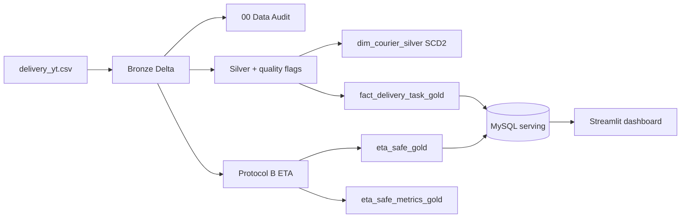

# Lakehouse LaDe-D — Phân tích giao hàng và dự đoán ETA

Đồ án xây dựng hệ thống Lakehouse cho dữ liệu giao hàng LaDe-D tại Yantai. Hệ thống đi từ dữ liệu thô, audit chất lượng, ETL Spark/Delta Lake, mô hình ETA kiểm soát leakage, các bảng serving MySQL đến dashboard Streamlit tiếng Việt.

## 1. Bài toán

File `data/delivery_yt.csv` là lát dữ liệu Yantai của LaDe-D, grain một dòng cho một `order_id`.

| Thuộc tính | Giá trị |
|---|---:|
| Số dòng | 206.431 |
| Số cột | 17 |
| Thành phố | Yantai |
| Shipper | 205 |
| Khu vực | 17 |
| AOI | 8.163 |
| SHA-256 | `aa5bca7fdaa8c89d4ab50a2ed2b94fb09f608acc49fc1108a1a612e9c0f5a7ad` |

`delivery_minutes` là thời gian từ lúc shipper nhận đơn đến lúc hoàn tất giao, không phải thời gian lái xe. Bài toán chính của đồ án là ETA tại một query time:

```text
target_remaining_minutes = delivery_ts - query_ts
```

Mô hình trả lời câu hỏi: tại thời điểm hệ thống quan sát được trạng thái đơn, còn khoảng bao nhiêu phút nữa đơn sẽ hoàn tất?

> **Cập nhật:** `query_ts = accept_ts` nên Protocol A-lite/B ở dưới thực chất vẫn là ETA lúc nhận đơn (MAE khoảng 100 phút, không so được với bài báo). Bài toán ETA đúng bài báo LaDe là **Protocol P** (mục 5b).

Bài toán cũ trong notebook 04 dự đoán toàn bộ `delivery_minutes` ngay khi nhận đơn và được giữ làm baseline phụ. Không so sánh trực tiếp metric của bài toán phụ với Protocol B vì nhãn, feature và tập đánh giá khác nhau.

## 2. Kiến trúc

Sơ đồ dạng text đầy đủ: [docs/data_warehouse.txt](docs/data_warehouse.txt).



| Thành phần | Vai trò | Cổng |
|---|---|---:|
| MinIO | Object storage S3 cho CSV và Delta | 9000, 9001 |
| Spark/Delta | ETL Bronze → Silver → Gold | nội bộ |
| Jupyter | Notebook và kiểm tra thủ công | 8888 |
| Prefect | Điều phối pipeline | 4200 |
| MySQL | Bảng serving cho dashboard | 3306 |
| Streamlit | Dashboard tiếng Việt | 8501 |
| Metabase | Khám phá dữ liệu bổ sung | 3000 |


### Kho dữ liệu theo star schema

Fact trung tâm `fact_delivery_task_gold` (grain một dòng cho một đơn giao) nối với 5 dimension: `dim_courier_silver` (SCD2), `dim_region_gold`, `dim_aoi_gold`, `dim_date_gold` (hai vai: ngày nhận và ngày giao), `dim_hour_gold`. Có thêm các fact ETA (`eta_safe_gold`, `eta_paper_gold`) và bảng audit `delivery_rejected`. Chi tiết, lý do thiết kế và các giới hạn: [docs/star_schema.md](docs/star_schema.md); sơ đồ dạng text: [docs/data_warehouse.txt](docs/data_warehouse.txt).

## 3. Audit và tiền xử lý dữ liệu

Chạy audit trước Silver:

```powershell
.venv/Scripts/python.exe scripts/profile_delivery.py
```

Kết quả nằm trong `reports/data/`. Bản local có 369 dòng duration bằng 0, 2.650 dòng dài hơn 24 giờ, 2.424 dòng accept GPS không hợp lệ, 122 dòng có khoảng cách stop–accept GPS trên 50 km và 2.987 dòng giao khác ngày nhận. Không có order ID trùng và không có duration âm.

Các cờ `q_*` được giữ để phân tích. Ngưỡng 24 giờ và 50 km là policy tạo cohort mô hình, không phải bộ lọc âm thầm. Xem thêm [docs/00_data_audit.md](docs/00_data_audit.md), [reports/data/README.md](reports/data/README.md) và [docs/data_dictionary.md](docs/data_dictionary.md).

## 4. Các tầng dữ liệu

**Bronze** giữ nguyên 17 cột nguồn dạng chuỗi và metadata lineage. Không ép kiểu hay xóa dòng ở tầng này.

**Silver** parse timestamp, ép kiểu số, tính `delivery_minutes`, `day_gap`, khoảng cách Haversine và cờ chất lượng. Dòng có khóa không hợp lệ hoặc duration không dương được ghi vào `delivery_rejected` cùng `reject_reason`. Các dòng >24 giờ, GPS thiếu, khoảng cách xa hoặc qua ngày vẫn được giữ trong Silver và chỉ được lọc khi một cohort cụ thể khai báo.

**Dimension/fact** gồm `dim_courier_silver` với lịch sử SCD2 theo ngày và `fact_delivery_task_gold` với grain một dòng/một đơn hàng. SCD2 là thành phần kiến trúc, không được tuyên bố là nguyên nhân cải thiện ETA. Xem [docs/star_schema.md](docs/star_schema.md).

## 5. Protocol ETA và chống leakage

`config/schema.yaml` là nguồn máy đọc được cho data dictionary và allowlist. Mỗi cột có status `allowed`, `forbidden`, `label` hoặc `ignored` kèm lý do.

- `completed`: được dùng `delivery_ts` và `delivery_gps_*` nếu `delivery_ts <= query_ts`.
- `pending`: giữ thuộc tính đã biết khi nhận đơn, che các trường phát sinh sau giao.
- `candidate`: chỉ dùng dữ liệu đã biết tại query time; không dùng `delivery_gps_*` của candidate.
- `label`: truyền riêng, không đưa vào feature matrix.

`delivery_gps` của đơn hoàn tất trước query được dùng để biểu diễn vị trí cuối đã quan sát. `delivery_gps` của pending/candidate chưa giao bị cấm.

Protocol B dùng số đơn pending, số đơn hoàn tất, courier history expanding với điều kiện `delivery_ts <= query_ts`, vị trí giao cuối đã quan sát, khoảng cách tới candidate và thuộc tính candidate. Không dùng leave-one-out nhìn thấy đơn tương lai. Cold-start được impute bằng thống kê học từ train.

LightGBM chạy objective L1 với `num_threads=1`, deterministic, `force_row_wise=true` và các seed 42, 43, 44. Cấu hình và quy tắc đánh giá nằm trong `config/prereg.yaml` và `config/freeze-v1.yaml`.

Kiểm thử contract/leakage:

```powershell
.venv/Scripts/python.exe scripts/validate_schema.py
.venv/Scripts/python.exe -m pytest -q
```

Bộ test kiểm tra cột chưa khai báo, cột ignored không lọt vào feature, pending được giữ khi truncation và feature không thay đổi khi thêm dữ liệu giao tương lai. Xem [docs/leak_inventory.md](docs/leak_inventory.md).

## 5b. Protocol P: ETA theo bài báo LaDe

Protocol P chép đúng quy trình `time_prediction` của LaDe (arXiv 2306.10675): truy vấn tại lúc shipper giao xong một đơn; với mỗi đơn còn đang cầm (đã nhận trước thời điểm đó, giao sau đó), nhãn là số phút còn lại. Chỉ giữ nhãn trong 1-120 phút, cần ít nhất 2 đơn còn lại, cửa sổ 24 đơn, tối đa 12 truy vấn mỗi cửa sổ, chia 60/20/20 theo ngày (bỏ ngày sát ranh giới). Code: `src/eta/paper_protocol.py`; chạy: `python scripts/run_paper_protocol.py`.

| Mô hình (test, 198.463 cặp) | MAE | RMSE (kiểu bài báo) | ACC@20 |
|---|---:|---:|---:|
| Trung vị train | 28,5 | 32,8 | 36,6 |
| SPEED | 33,6 | 40,0 | 40,7 |
| LightGBM (3 seed, 8 feature) | 20,7 | 24,9 | 59,2 |
| Bài báo: SPEED / LightGBM / M2G4RTP | 33,97 / 23,32 / 17,21 | 40,27 / 27,82 / 19,71 | 42,0 / 51,2 / 69,2 |

Lưu ý khi diễn giải: bộ lọc nhãn 1-120 phút loại khoảng 48% cặp (truy vấn, đơn), nên sai số chỉ áp dụng cho các đơn sắp giao. Dùng haversine thay `geopy.geodesic`; chưa có code LightGBM gốc nên chỉ so "cùng cỡ", không phải bản sao. Tốc độ shipper tính trên toàn file như code gốc (rò rỉ nhẹ, chỉ ảnh hưởng SPEED). Đăng ký thiết kế bổ sung: `config/prereg-addendum-p.yaml`.

## 6. Cài đặt Docker

Yêu cầu Docker Desktop, Docker Compose v2, ít nhất 6–8 GB RAM cho Docker và vài GB dung lượng trống. Kiểm tra file dữ liệu đúng SHA-256 ở trên.

Tạo cấu hình local nếu cần:

```powershell
Copy-Item .env.example .env
```

Mặc định dùng MinIO `minioadmin/minioadmin`, MySQL `delivery/delivery`, database `delivery_source`. Không commit `.env`.

Khởi động:

```powershell
docker compose up -d --build
docker compose ps
```

Upload `delivery_yt.csv` vào bucket `lakehouse` tại `http://localhost:9001` nếu muốn đọc từ MinIO. Nếu không upload, ingest có fallback về file local đã mount tại `/home/jovyan/data/delivery_yt.csv`.

Chạy toàn bộ flow:

```powershell
docker compose exec jupyter python /home/jovyan/pipeline/flow.py
```

Flow gồm Bronze → Silver → SCD2 → task 4b ETA leakage-safe → fact/model phụ → serving MySQL. Thành công khi log có `Flow run ... Finished in state Completed()`.

Theo dõi log:

```powershell
docker compose logs -f jupyter
docker compose logs -f dashboard
```

## 7. Dashboard

Mở `http://localhost:8501` sau khi flow hoàn tất. Dashboard mới có bốn nhóm:

1. **Tổng quan:** tổng đơn, shipper, median, tỷ lệ chậm, xu hướng theo ngày và phân phối thời gian.
2. **Shipper & khu vực:** lọc khu vực, số đơn tối thiểu, xếp hạng shipper, scatter số đơn/thời gian/tỷ lệ chậm, so sánh khu vực và giờ nhận.
3. **Mô hình ETA:** metric Protocol B theo seed, metric bài toán phụ, feature importance và ghi chú phân biệt hai bài toán.
4. **Chất lượng & lineage:** hash dữ liệu, thông tin lần chạy, bảng pipeline và tải CSV.

Dashboard chỉ đọc bảng serving MySQL, không chạy lại pipeline. Bấm `Làm mới dữ liệu` sau khi chạy flow mới. Bảng Protocol B mới là `eta_safe_metrics`; nếu chưa có bảng này, hãy build lại image và chạy flow lại.

## 8. Các bảng đầu ra

Delta/MinIO: `delivery_bronze`, `delivery_silver`, `delivery_rejected`, `dim_courier_silver`, `fact_delivery_task_gold`, `eta_safe_gold`, `eta_safe_metrics_gold`, `eta_paper_gold`, `eta_paper_metrics_gold`.

MySQL: `agg_overview`, `agg_region_daily`, `agg_region_summary`, `agg_hourly`, `agg_courier_performance`, `agg_region_error`, `ml_metrics`, `ml_feature_importance`, `eta_safe_metrics`, `eta_paper_metrics`, `pipeline_run_info`.

## 9. Kiểm tra local và notebook

Notebook chỉ dùng để trình bày/khám phá; logic chính nằm trong `src/eta/` để test được. Thứ tự notebook là `00_data_audit`, `01_ingest_bronze`, `02_transform_silver`, `03_dim_courier_silver`, `04_fact_and_ml_gold`.

```powershell
.venv/Scripts/python.exe scripts/profile_delivery.py
.venv/Scripts/python.exe scripts/validate_schema.py
.venv/Scripts/python.exe -m pytest -q
.venv/Scripts/python.exe scripts/run_eta_experiment.py --protocol B
```

## 10. Dừng và xử lý lỗi

```powershell
docker compose down       # dừng service, giữ volume
docker compose down -v    # reset toàn bộ volume
```

Nếu thiếu JAR hoặc dependency, build lại:

```powershell
docker compose build --no-cache lakehouse jupyter
docker compose up -d
```

Nếu Jupyter chưa healthy:

```powershell
docker compose logs --tail=200 jupyter
docker compose restart jupyter
```

Nếu dashboard báo chưa có dữ liệu:

```powershell
docker compose exec mysql mysql -udelivery -pdelivery delivery_source -e "SHOW TABLES;"
docker compose logs dashboard
```

## 11. Giới hạn và nguồn tham khảo

File hiện chỉ có một thành phố nên không được suy rộng kết quả sang thành phố khác. Một số GPS/timestamp là quan sát đã ghép sẵn trong dataset; thời điểm biết của từng cột được ghi tại `config/schema.yaml`. Protocol B dùng pandas `toPandas()` cho 206 nghìn dòng, phù hợp quy mô luận văn hiện tại nhưng chưa phải thiết kế phân tán cho dữ liệu rất lớn. Spark/Delta được dùng cho ETL và kiến trúc Lakehouse; LightGBM dùng cho mô hình trên một máy.

Nguồn tham khảo: repository `wenhaomin/LaDe`, dataset card `Cainiao-AI/LaDe` trên Hugging Face, paper và các bản lưu trong `reports/data/sources`.
